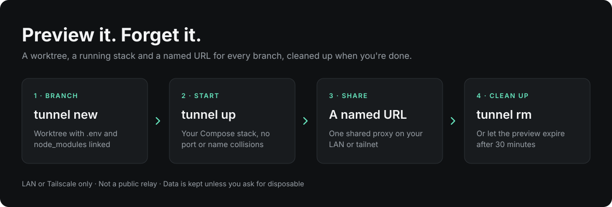

<h1 align="center">tunnel</h1>

---

<p align="center">
  <b>A named URL for every branch. Nothing left behind.</b><br>
  Tunnel runs your Compose app from its own worktree, shares it on your LAN or tailnet,<br>
  and removes the containers, images and worktree when you're done.
</p>

<p align="center">
  <a href="#quick-start"></a>
  <a href="docs/networking.md"></a>
</p>

<p align="center">
  <a href="https://github.com/avyayv/tunnel/actions/workflows/test.yml"></a>
</p>

<p align="center">
  
</p>

> **Private network only.** URLs work on devices that can reach your machine, such as your LAN or [Tailscale](https://tailscale.com/). Tunnel is not a public relay and adds no authentication or HTTPS.

## Quick Start

You need [Bun](https://bun.sh/), Git, and Docker with [Compose 2.24 or later](https://docs.docker.com/compose/). Tested on macOS with OrbStack; Linux is untested.

```sh
curl -fsSL https://raw.githubusercontent.com/avyayv/tunnel/main/install.sh | bash
```

Add the printed `~/.local/bin` line to your PATH if asked, then start the bundled example:

```sh
tunnel up --name hello ~/.local/share/tunnel/examples/hello
```

Open the URL it prints, port included (for example `http://hello.192.168.1.10.nip.io:8000`). Stop it with `tunnel down hello`, or leave it: it expires in 30 minutes.

Rerun the install command to update. If tunnel can't pick an address, see [network setup](docs/networking.md#configure-your-network).

## What You Get

- **Named URLs.** Every preview gets `<name>.<your-ip>.nip.io`, or a name under your own domain, through one shared Caddy proxy.
- **No collisions.** Fixed ports, container names, volumes and networks become per-preview, so several branches of one project run side by side.
- **Leases.** Previews expire after 30 minutes unless you extend them.
- **Worktrees.** Create a ready-to-run worktree per branch, and delete it together with everything it started.
- **Disk cleanup.** Clear out stacks, images and build cache that deleted worktrees left behind.
- **Existing dev servers.** Give an app you already started a named URL.
- **Agent skill.** A bundled skill teaches coding agents to start, verify and share previews.

## Commands

| Command | What it does |
| --- | --- |
| `tunnel up [dir]` | Start a Compose app and give it a named URL |
| `tunnel ls` | List previews, URLs and expiry |
| `tunnel extend NAME [1h\|never]` | Extend a lease, or disable expiry |
| `tunnel down [name\|dir]` | Tear a preview down now |
| `tunnel cleanup` | Remove expired previews |
| `tunnel new BRANCH` | Create a worktree and print its path |
| `tunnel rm [dir]` | Delete a worktree and everything started in it |
| `tunnel prune` | Remove stacks whose directory is gone, untagged images and old build cache |
| `tunnel setup` | Save the IP, domain, port and worktree directory |
| `tunnel doctor` | Check Docker, the proxy, DNS and each preview |

`tunnel --help` lists every flag.

## Previews

From a directory with a Compose file:

```sh
tunnel up --name my-branch --build .
```

Run it again in the same directory to rebuild and renew the lease. Use a different name for each worktree.

Tunnel finds the port to route by sending one GET to each published port, so your app may see that request. To choose yourself, pass `--target SERVICE:PORT`. Other useful flags:

- `--profile` and `--service` select what Compose starts.
- `--url-env VARIABLE` sets that variable to the preview URL before the app starts, for OAuth callbacks and public URLs.
- `--ttl never` disables expiry, and `--disposable` deletes the preview's volumes on teardown.

For a dev server you started yourself:

```sh
tunnel up --local --name my-app --port 5173 .
```

Tunnel only routes it. Expiry removes the URL, not the server.

## Worktrees

```sh
cd "$(tunnel new my-branch)"     # worktree at ~/.worktrees/my-branch
tunnel up --name my-branch --build .
cd "$(tunnel rm)"                # back in the main checkout
```

`tunnel new` checks out the branch if it exists locally or on `origin`, and otherwise creates it from `HEAD` (or `--from REF`). It symlinks `.env*` files and `node_modules` from the main checkout so the worktree runs right away. Change the location with `tunnel setup --worktrees DIR`.

`tunnel rm` removes the worktree along with every preview and Compose stack started in it, including ones started with plain `docker compose up`, plus their volumes and built images. It refuses uncommitted or untracked work unless you pass `--force`. Pass `--keep-volumes` to keep the data.

## Cleanup

Previews expire after 30 minutes. On macOS a launchd job checks every minute, even after your terminal closes. Elsewhere, pass `--ttl never` and run `tunnel down` yourself.

Teardown removes containers, networks and built images but **keeps volumes**, so the next `up` in the same directory picks the data back up. Volumes go when you use `--disposable`, `tunnel rm` or `tunnel prune`.

`tunnel prune` cleans up after worktrees deleted some other way: stacks whose directory no longer exists, with their volumes and images, plus untagged images and build cache older than a week. `--dry-run` shows what it would remove. On macOS this runs hourly for deleted worktrees in the worktree directory.

## Network Setup

Tunnel uses your Tailscale IPv4 address, or a private LAN address when there is only one candidate, with [nip.io](https://nip.io/) for DNS. Set the address yourself with `tunnel setup --ip <IPv4>`.

The proxy listens on all interfaces by default, so use a trusted network or restrict it with `tunnel setup --bind`. `tunnel doctor` checks the setup, but a request that works locally doesn't prove another device can reach the URL.

The [networking guide](docs/networking.md) covers [custom domains and split DNS](docs/networking.md#configure-your-network), [settings and environment variables](docs/networking.md#settings), and [troubleshooting](docs/networking.md#troubleshoot-and-verify).

## Coding Agents

`tunnel --skill` prints the bundled [Tunnel Preview skill](skills/tunnel-preview/SKILL.md). Save it wherever your agent loads skills, for example:

```sh
mkdir -p ~/.codex/skills/tunnel-preview
tunnel --skill > ~/.codex/skills/tunnel-preview/SKILL.md
```

## Uninstall

Stop active previews (`tunnel ls`, then `tunnel down <name>`), then remove the command and checkout:

```sh
rm ~/.local/bin/tunnel
rm -rf ~/.local/share/tunnel
```

Configuration, kept volumes and Docker images stay in place.

## Development

```sh
bun test
bun cli.ts --help
```

Tests use fake Docker and launchctl commands with isolated state, so they start no containers or scheduled jobs.
