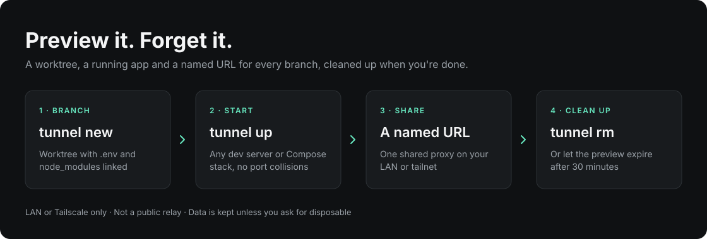

<h1 align="center">tunnel</h1>

---

<p align="center">
  <b>A named URL for every branch. Nothing left behind.</b><br>
  Tunnel gives each branch its own worktree, runs any app in it (a dev server or a Compose stack),<br>
  shares it on your LAN or tailnet, and stops and removes everything when you're done.
</p>

<p align="center">
  <a href="#quick-start"></a>
  <a href="docs/networking.md"></a>
</p>

<p align="center">
  <a href="https://github.com/avyayv/tunnel/actions/workflows/test.yml"></a>
</p>

<p align="center">
  
</p>

> **Private network only.** URLs work on devices that can reach your machine, such as your LAN or [Tailscale](https://tailscale.com/). Tunnel is not a public relay and adds no authentication or HTTPS.

## Quick Start

You need [Bun](https://bun.sh/), Git, and Docker, which runs the shared proxy. Compose apps need [Compose 2.24 or later](https://docs.docker.com/compose/). Tested on macOS with OrbStack; Linux is untested.

```sh
curl -fsSL https://raw.githubusercontent.com/avyayv/tunnel/main/install.sh | bash
```

Add the printed `~/.local/bin` line to your PATH if asked, then serve a directory:

```sh
tunnel up --name hello -- 'python3 -m http.server $PORT'
```

Open the URL it prints, port included (for example `http://hello.192.168.1.10.nip.io:8000`). Stop it with `tunnel down hello`, or leave it: it expires in 30 minutes and the server stops with it.

Rerun the install command to update. If tunnel can't pick an address, see [network setup](docs/networking.md#configure-your-network).

## What You Get

- **Any command.** `tunnel up -- npm run dev` runs the command in the background, finds the port it serves and gives it a URL. No config.
- **Named URLs.** Every preview gets `<name>.<your-ip>.nip.io`, or a name under your own domain, through one shared Caddy proxy.
- **No collisions.** Commands get a free `PORT`; Compose stacks get per-preview ports, container names, volumes and networks. Several branches of one project run side by side.
- **Leases.** Previews expire after 30 minutes unless you extend them, and expiry stops what they run.
- **Worktrees.** Create a ready-to-run worktree per branch, and delete it together with everything it started.
- **Disk cleanup.** Clear out stacks, images and build cache that deleted worktrees left behind.
- **Agent skill.** A bundled skill teaches coding agents to start, verify and share previews.

## Commands

| Command | What it does |
| --- | --- |
| `tunnel up [dir] [-- command]` | Run a command (or the directory's Compose app) and give it a named URL |
| `tunnel ls` | List previews, URLs and expiry |
| `tunnel logs NAME [-f]` | Show a command's output |
| `tunnel extend NAME [1h\|never]` | Extend a lease, or disable expiry |
| `tunnel down [name\|dir]` | Tear a preview down now |
| `tunnel cleanup` | Remove expired previews |
| `tunnel new BRANCH` | Create a worktree and print its path |
| `tunnel rm [dir]` | Delete a worktree and everything started in it |
| `tunnel prune` | Remove stacks whose directory is gone, untagged images and old build cache |
| `tunnel setup` | Save the IP, domain, port and worktree directory |
| `tunnel doctor` | Check Docker, the proxy, DNS and each preview |

`tunnel --help` lists every flag.

## Previews

Give `tunnel up` any command after `--`:

```sh
tunnel up --name my-branch -- npm run dev
tunnel up --name api -- 'uvicorn app:app --port $PORT'
```

Tunnel starts the command in the background in the current directory (or the one you name before `--`), with `PORT` set to a free port and `TUNNEL_URL` set to the preview URL. Apps that ignore `PORT`, like Vite on 5173, work too: tunnel routes whichever port the command's processes answer HTTP on. If it serves on a known port, pass `--port`. A single argument runs through `sh`, so quote it to use `$PORT`, `&&` or pipes.

The command keeps running after your terminal closes. `tunnel logs my-branch -f` follows its output; `tunnel down`, expiry and `tunnel rm` stop it along with every process it started. If it exits before serving HTTP, `up` fails and shows its last output. It must stay in the foreground: tunnel hides coding-agent markers like `CLAUDECODE` from it, since some tools (Astro 7's dev server) detach into the background when they see one.

Many dev servers answer only to `localhost`; `up` warns when the app rejects the preview's hostname. Allow it with Vite's `server.allowedHosts` (also SvelteKit and Astro's `--allowed-hosts`), Django's `ALLOWED_HOSTS`, or Jupyter's `--ServerApp.allow_remote_access=True`. If the app picks a port another server already uses on a different address (a second Vite on 5173, say), `up` refuses rather than risk routing to the wrong one; give it `$PORT`, as in `npm run dev -- --port $PORT --strictPort`.

Tested with Next.js, Vite + React, SvelteKit, Astro, Docusaurus, Express, Hono on Bun, Deno's file server, Django, FastAPI, Flask, Streamlit, JupyterLab, PocketBase, Excalidraw via `docker run`, and Gitea with Postgres via Compose, including Vite, Streamlit and Jupyter websockets through the proxy.

Without a command, `up` starts the directory's Compose file:

```sh
tunnel up --name my-branch --build .
tunnel up --name hello ~/.local/share/tunnel/examples/hello   # the bundled example
```

Tunnel finds the port to route by sending one GET to each published port, so your app may see that request. To choose yourself, pass `--target SERVICE:PORT`. `--profile` and `--service` select what Compose starts, and `--disposable` deletes the preview's volumes on teardown.

Either way, run `up` again in the same directory to restart (or rebuild) the app and renew the lease; it reuses the command and options from last time. Use a different name for each worktree. `--url-env VARIABLE` sets that variable to the preview URL before the app starts, for OAuth callbacks and public URLs, and `--ttl never` disables expiry.

For a server something else started and keeps running:

```sh
tunnel up --local --name my-app --port 5173 .
```

Tunnel only routes it. Expiry removes the URL, not the server.

## Worktrees

```sh
cd "$(tunnel new my-branch)"     # worktree at ~/.worktrees/my-branch
tunnel up --name my-branch --build .
cd "$(tunnel rm)"                # back in the main checkout
```

`tunnel new` checks out the branch if it exists locally or on `origin`, and otherwise creates it from `HEAD` (or `--from REF`). It symlinks `.env*` files and `node_modules` from the main checkout so the worktree runs right away. Change the location with `tunnel setup --worktrees DIR`.

`tunnel rm` removes the worktree along with every preview started in it, stopping its commands and Compose stacks, plus any Compose stack started there with plain `docker compose up`, their volumes and built images. It refuses uncommitted or untracked work unless you pass `--force`. Pass `--keep-volumes` to keep the data.

## Cleanup

Previews expire after 30 minutes. On macOS a launchd job checks every minute, even after your terminal closes. Elsewhere, pass `--ttl never` and run `tunnel down` yourself.

Teardown stops a command's whole process group (SIGTERM, then SIGKILL after 10 seconds). For Compose it removes containers, networks and built images but **keeps volumes**, so the next `up` in the same directory picks the data back up. Volumes go when you use `--disposable`, `tunnel rm` or `tunnel prune`.

`tunnel prune` cleans up after worktrees deleted some other way: stacks whose directory no longer exists, with their volumes and images, plus untagged images and build cache older than a week. `--dry-run` shows what it would remove. On macOS this runs hourly for deleted worktrees in the worktree directory.

## Network Setup

Tunnel uses your Tailscale IPv4 address, or a private LAN address when there is only one candidate, with [nip.io](https://nip.io/) for DNS. Set the address yourself with `tunnel setup --ip <IPv4>`.

The proxy listens on all interfaces by default, so use a trusted network or restrict it with `tunnel setup --bind`. `tunnel doctor` checks the setup, but a request that works locally doesn't prove another device can reach the URL.

The [networking guide](docs/networking.md) covers [custom domains and split DNS](docs/networking.md#configure-your-network), [settings and environment variables](docs/networking.md#settings), and [troubleshooting](docs/networking.md#troubleshoot-and-verify).

## Coding Agents

`tunnel --skill` prints the bundled [Tunnel Preview skill](skills/tunnel-preview/SKILL.md). Save it wherever your agent loads skills, for example:

```sh
mkdir -p ~/.codex/skills/tunnel-preview
tunnel --skill > ~/.codex/skills/tunnel-preview/SKILL.md
```

## Uninstall

Stop active previews (`tunnel ls`, then `tunnel down <name>`), then remove the command and checkout:

```sh
rm ~/.local/bin/tunnel
rm -rf ~/.local/share/tunnel
```

Configuration, kept volumes and Docker images stay in place.

## Development

```sh
bun test
bun cli.ts --help
```

Tests use fake Docker and launchctl commands with isolated state, so they start no containers or scheduled jobs; command previews run small real servers. Code is split by concern: `cli.ts` parses arguments, `preview.ts` runs the up/down lifecycle, `command.ts` and `compose.ts` start and stop the two kinds of app, `proxy.ts` owns routes, `lease.ts` expiry, `prune.ts` and `worktree.ts` cleanup.
