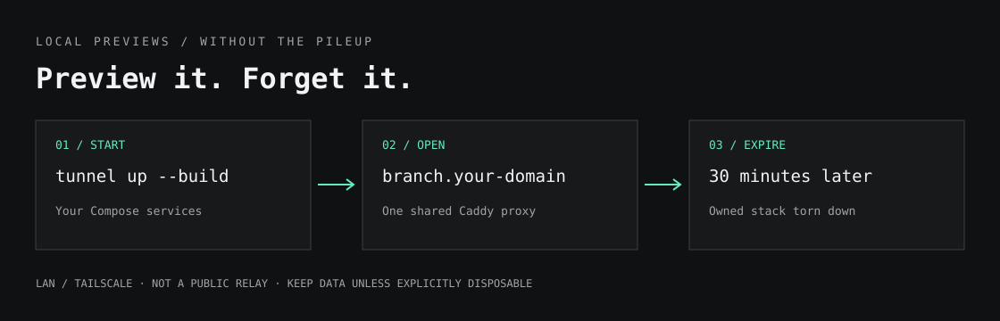

<h1 align="center">tunnel</h1>

<p align="center">
  <b>Local previews. Named URLs. Automatic cleanup.</b><br>
  Start your Docker Compose app, share it on your LAN or tailnet, and let it expire.
</p>

<p align="center">
  <a href="#quick-start">Quick Start</a> ·
  <a href="#preview-your-branch">Branch Previews</a> ·
  <a href="#cleanup-without-surprises">Cleanup</a> ·
  <a href="docs/networking.md#configure-your-network">Network Setup</a> ·
  <a href="skills/tunnel-preview/SKILL.md">Agent Skill</a>
</p>

<p align="center">
  
</p>

Testing a branch shouldn't leave another stack running forever. Tunnel gives each preview a named URL and a **30-minute lease**. Extend it when you need more time; otherwise its owned Compose stack is torn down automatically.

**Not a public relay.** URLs work only on devices that can reach your machine—such as your LAN or [Tailscale](https://tailscale.com/) network. Tunnel provides no authentication or HTTPS. Automatic expiry currently requires macOS; on other platforms, create previews with `--ttl never` and teardown is manual.

## Quick Start

Requires [Bun](https://bun.sh/), Git, and running Docker with [Compose v2](https://docs.docker.com/compose/). Install with the standard GitHub `curl | bash` pattern:

```sh
curl -fsSL https://raw.githubusercontent.com/avyayv/tunnel/main/install.sh | bash
export PATH="$HOME/.local/bin:$PATH"

tunnel up --name hello ./examples/hello
```

The installer clones or fast-forward updates the checkout at `~/.local/share/tunnel` and links `~/.local/bin/tunnel` to it. It refuses to overwrite an unrelated install or command. For custom paths, set `TUNNEL_INSTALL_DIR` and/or `TUNNEL_BIN_DIR` before running the installer. Alternatively, install from source manually:

```sh
git clone https://github.com/avyayv/tunnel.git
cd tunnel
mkdir -p ~/.local/bin
ln -s "$PWD/cli.ts" ~/.local/bin/tunnel
export PATH="$HOME/.local/bin:$PATH"

tunnel up --name hello ./examples/hello
tunnel ls
tunnel doctor
```

Open the **complete URL printed by `up`**, including its port—for example, `http://hello.192.168.1.10.nip.io:8000`. The bundled example runs nginx with a dynamically assigned host port. Tunnel chooses a Tailscale IPv4 address, or an unambiguous private LAN IPv4 address, and uses [nip.io](https://nip.io/) for DNS. If detection is ambiguous, run `tunnel setup --ip <your-reachable-IPv4>` first.

```sh
tunnel extend hello 30m   # Need more time?
tunnel down hello        # Done already?
```

Keep the checkout in place: the executable loads supporting files from it. The installer refuses to overwrite an existing unrelated `~/.local/bin/tunnel`. Add the PATH setting to your shell configuration. Re-run the installer to update the checkout.

**Exposure:** proxy and example ports bind all interfaces by default. Use a trusted network or configure a local bind and firewall first. DNS names are not access control. See [network setup and limitations](docs/networking.md#configure-your-network).

## Preview Your Branch

### Docker Compose

From a repository or worktree with `compose.yaml`, `compose.yml`, `docker-compose.yaml`, or `docker-compose.yml`:

```sh
tunnel up --name my-branch --build .
```

Each name owns a Compose project named `tunnel-<name>`. Tunnel starts and reuses one shared Caddy proxy for all previews. Repeat `up` in the same worktree to reuse its registered name and renew its lease. Names cannot silently move between checkouts. Multiple previews are allowed; each gets its own expiry.

Start only the services you need, enable a profile, and inject the final browser origin (scheme, hostname, and port) before Compose starts:

```sh
tunnel up --name my-branch --build \
  --service api --profile sandbox --target api:8080 \
  --url-env APP_PUBLIC_URL .
```

Use **your app's actual environment variable name**, not necessarily `APP_PUBLIC_URL`. Repeat `--service`, `--profile`, or `--url-env` as needed. Compose handles dependencies; tunnel does not configure your OAuth provider or load secrets from anywhere beyond your existing Compose environment/.env behavior.

If the stack publishes multiple ports, use `--target <service>:<container-port>` to resolve its published host port after startup, or select a known **host port** with `--port`. Tunnel does not allocate ports or rewrite Compose files. Use ephemeral published ports in your Compose file when running worktrees side by side. Fixed ports can conflict.

### Already-Running Apps

```sh
tunnel up --local --name my-app --port 5173 .
```

This borrows a server you started yourself—even if the directory contains a Compose file. **Expiry removes only the route, not the server.** For full-stack automatic teardown, let tunnel start Compose instead of pairing a separate `compose up` with `--local`.

The app must accept requests from Docker via `host.docker.internal` and allow the printed hostname. Linux loopback-only servers generally aren't reachable from Docker bridge containers. See [routing an existing server](docs/networking.md#already-running-server).

## Cleanup Without Surprises

| Action | What Happens |
| --- | --- |
| `tunnel up …` | New preview gets a 30-minute lease |
| `tunnel extend my-branch 1h` | Resets expiry to one hour from now |
| `tunnel extend my-branch never` | Keeps the preview until manual teardown |
| `tunnel ls` | Shows registered URLs, source paths, and expiry |
| `tunnel cleanup` | Tears down expired previews; failures remain for retry |
| `tunnel down my-branch` | Tears down immediately |

On macOS, `up` installs a user **launchd** job that checks expiry every minute, independently of your terminal or coding agent. Missed cleanup checks run after wake if the laptop sleeps. If Docker is unavailable, the job retries every minute; it does not start Docker itself. Teardown isn't guaranteed at the exact second of expiry. The small cleanup job and a snapshot of its runtime stay installed between previews, so deleting the source worktree won't break expiry.

**Data is retained by default.** Containers and networks are removed, but Compose volumes remain. For genuinely throwaway previews:

```sh
tunnel up --name scratch --build --disposable .
```

`--disposable` authorizes volume deletion on manual or automatic teardown and must be selected when creating the preview, not added later. Don't use it for data you want to keep. Without it, named and anonymous volumes remain and may consume disk. Once a preview is removed, reusing its name is refused if retained resources exist—inspect those resources or choose a new name; tunnel won't silently adopt another checkout's database. External Compose volumes without the preview's project label aren't deleted; images, build cache, and bind-mounted host data are untouched. Previously registered previews without an expiry remain untouched until you explicitly renew them. Borrowed local servers and the shared proxy remain running.

Expiry controls running stacks, **not Docker's global disk cache**. Images and build cache may remain; tunnel doesn't run a blanket system/volume prune or delete unrelated repositories' data.

## Coding Agents

```sh
tunnel --skill
```

The bundled [Tunnel Preview skill](skills/tunnel-preview/SKILL.md) makes tunnel the first choice for branch previews: minimal services, public URL configured before boot, a bounded lease, and verification before sharing the link. Install it in your agent's skill directory and refresh it when updating tunnel.

```sh
mkdir -p ~/.codex/skills/tunnel-preview
cp skills/tunnel-preview/SKILL.md ~/.codex/skills/tunnel-preview/SKILL.md
```

## Network Setup and Troubleshooting

- [Choose an IP, custom domain, or split DNS](docs/networking.md#configure-your-network)
- [Configuration flags and environment variables](docs/networking.md#settings)
- [502s, DNS, port conflicts, OAuth, and interrupted commands](docs/networking.md#troubleshoot-and-verify)

`tunnel doctor` checks Docker, Compose, proxy ownership, wildcard DNS, and registered HTTP targets. Authenticated apps may require a manual check. A successful local request doesn't prove another device can reach the URL.

## Uninstall

Stop active previews first with `tunnel ls` and `tunnel down <name>`. Then remove the command link and checkout:

```sh
rm ~/.local/bin/tunnel
rm -rf ~/.local/share/tunnel
```

This does not remove tunnel configuration, retained Compose volumes, or Docker images.

## Development

```sh
bun test
bun cli.ts --help
```

Tests use fake Docker/launchctl commands and isolated state, not real containers or scheduled jobs.
